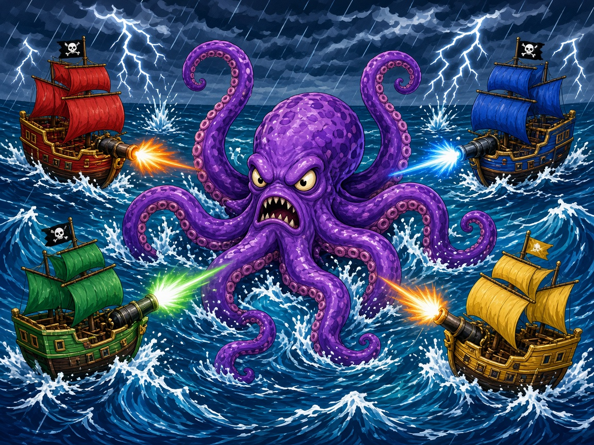

# Kraken Keepers

Four pirate ships share one screen and one sea. Steer with the wind still in your sails, rake the other crews with port and starboard broadsides, and scoop gold off wrecks and floating chests. Every few seconds the kraken marks the ship with the most gold and slams that patch of water. Get out of the circle or feed the deep.

A round lasts three minutes. The crew holding the most gold when the clock hits zero takes the round. First crew to win a majority of rounds takes the match. One player can sail with bots filling the empty helms.

## Launch

Python 3 is the only dependency, and the game never talks to a network. The server binds to `127.0.0.1`, prefers port **8807**, and moves to the next free port if that one is taken. It then opens the game in your browser.

### macOS

Double-click `launch-mac.command`, or from a terminal:

```bash
./launch-mac.command
```

### Windows

Double-click `launch-windows.bat`.

### Linux

```bash
./launch-linux.sh
```

### Already in a browser

From the repo root:

```bash
python3 server.py
```

`--no-browser` serves without opening a window. `--port 8807` picks a different preferred port. Opening `index.html` as a `file://` URL will not load the modules; use the server.

If Python 3 is missing, the launcher says so instead of failing silently.

## Controls

Everyone plays on the same keyboard. A gamepad in slot 0–3 takes over that player (left stick or D-pad to sail, A for port cannons, B for starboard cannons, Start to pause) and leaves the others on keys. Pads can be plugged in mid-match. The HUD shows a pad glyph for each connected controller. Bindings can be changed on the Controls screen and are stored in `localStorage`.

| Player | Sail | Port cannons | Starboard cannons |
| --- | --- | --- | --- |
| P1 | W A S D | F | G |
| P2 | Arrow keys | / | . |
| P3 | I J K L | ; | ' |
| P4 | Numpad 8 / 4 / 5 / 6 | Numpad 0 | Numpad Enter |
| Gamepad | Left stick or D-pad | A | B |

Numpad 8 is forward, 5 is reverse, 4 turns to port, 6 turns to starboard.

| Action | Key |
| --- | --- |
| Start / join / confirm | Enter or Start |
| Pause | Esc or Start |
| Mute | M |
| Join a helm | That player's port-cannon button |
| Cycle an empty helm (bot / off) | That player's starboard-cannon button |

On the title screen, C opens controls and O opens options (volume, round count, whether empty helms become bots).

## Rules

- Free-for-all. There are no teams.
- The hull has inertia: the bow turns before the wake does, and speed bleeds off instead of stopping dead.
- Port cannons fire to the left of the bow. Starboard cannons fire to the right. Each broadside is three shots, then the guns need a moment.
- Chests are worth 25 gold and come back. Coins spilled from a wreck are worth whatever was dropped.
- The kraken only bothers a crew that is actually ahead. It draws a circle on that ship, waits, then hits everyone still inside. Tied leaders are chosen with the match seed.
- A sunk ship drops half its gold, rounded down, keeps the rest, and respawns at its home buoy after 3 seconds with a short grace period.
- Powder makes the guns cycle faster. A wind charm pushes the hull harder. A patch repairs 40 hull and halves incoming damage while it lasts.
- Any helm left empty at the start can be a simple bot, so the game is playable alone.

## Scoring

- Each round is **3:00**. When it ends, the active ship with the most gold wins the round.
- Ties go to the crew sunk fewer times, then the crew that sank more ships, then the lower player number.
- A match is first to a majority: 1 round, best of 3, or best of 5. That choice is in Options and defaults to best of 3.
- The match winner is the crew with the most round wins. A remaining tie breaks on gold still aboard, then the lower player number.
- Round wins are marked on the HUD. The match screen lists the standings and offers a rematch.

## arcade.json

`arcade.json` is the Arcade OS manifest: display name, id `krakenkeepers`, cover and icon, the three launchers plus `index.html`, 4 players, minimum 1, keyboard and gamepad, version `1.0.0`, and port `8807`. Launchers and `server.py` read that port.

## Tests

No packages to install.

```bash
node --test tests/
python3 tests/smoke_server.py
```

The Node suite drives the simulation with no browser: movement and collision, scoring, round and match wins, sinking and respawn, chests, powder, wind, patch, the kraken, the seeded RNG, keyboard and mocked gamepad mapping, and a check that `arcade.json` points at files that exist. The Python smoke test starts `server.py` headless and fetches `index.html`.

GitHub Actions runs both on every push and pull request.

## License

[MIT](LICENSE).
